# Complete Drunagor Turn Tracker Tutorial

> **Beginner guide · 2026 edition**  
> This guide explains how to use the application. It does not replace the *Chronicles of Drunagor* rulebook. The app tracks the game state and automates part of the setup; rules, decisions and exceptions remain the table's responsibility.

> **Español:** [Leer el tutorial en español](TUTORIAL.md)

---

## 1. What this application is

**Drunagor Turn Tracker** is a digital companion for running *Chronicles of Drunagor* games. It brings together:

- The **initiative order**.
- The **current turn**, round and timer.
- Heroes, companions, pets and followers.
- Enemies, commanders, overlords, bosses and fallen heroes.
- Runes, bag, track, stacks, nodes and areas.
- The scenario monster and its incursion and defense cards.
- Conditions, immunities, health and action cubes.
- Campaign scenes and automatic chapter setup.
- Local saves, export and import.

### First things to know

| Concept | Meaning |
|---|---|
| **Local-first** | Everything is stored in your browser. There is no account or server. |
| **No installation** | It runs as a web page on phone, tablet or computer. |
| **Unofficial** | It is a personal tool, not an official game product. |
| **Private data** | Games do not sync across devices unless you export and import the JSON file. |
| **The app does not decide for you** | It does not validate every game rule; it records and helps prepare the table. |

> **Tip:** export your game before an important session. Browser storage can be cleared when you clean site data or change devices.

---

## 2. Overall flow

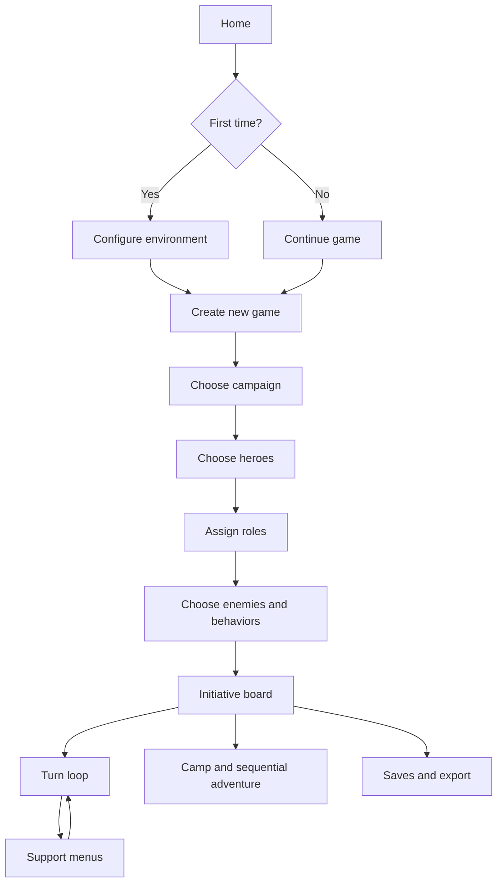

### Recommended first-time order

1. **Configure**: language, campaign, expansions and rules.
2. **Create game**: heroes and roles.
3. **Prepare the table**: enemies, runes, scenario and scenes.
4. **Play turns** on the board.
5. **Save or export** before closing.

---

## 3. Key concepts before using the board

### 3.1 Campaign, box and expansion

| Level | What it is | Where to choose it |
|---|---|---|
| **Campaign / box** | Base game, Awakenings or Apocalypse | Settings and first game step |
| **Expansion** | Additional content inside a campaign | Settings |
| **Scene / chapter** | Specific adventure setup | **Scenes** menu |

Active expansions filter heroes, enemies, cards and scenes. If an expansion is inactive, its content does not appear in normal selectors.

> **View other campaigns** lets you inspect another box's content without changing the active game. It does not make that campaign active.

### 3.2 Rules 1.5 and 2.0

Under **Settings → Rules version** you can choose:

- **Automatic**: uses 2.0 when Apocalypse expansions are active; otherwise 1.5.
- **1.5**: original rulebook.
- **2.0**: prepared for Apocalypse.

If you force 1.5 while Apocalypse expansions are active, the app displays a warning.

### 3.3 The initiative board

The board has **11 positions**:

- Role positions: Defender, Support, Leader, Striker and Controller.
- Rune positions: one per color.
- A final generic rune position.

Cards stack **above and below** the central bar. The central line moves independently according to the real space needed by the top and bottom stacks.

### 3.4 Visual codes

| Code / icon | Meaning |
|---|---|
| **MB** | White Monster |
| **MG** | Gray Monster |
| **MN** | Black Monster |
| **Commander** | Enemy with its own deck and PC value |
| **Boss** | Highlighted enemy; appears in the top banner |
| **Overlord** | Special enemy with its own cards |
| **Fallen hero** | Special defeated-hero card |
| **Crown / skull** | Boss or boss mechanic |
| **Round shield** | Immunity |
| **Time token** | Time counter on a card or defense |
| **Color dot** | Rune or generation color |

> Do not rely on color alone: the app adds initials, icons and labels so the same state is recognizable without color vision.

---

## 4. First launch

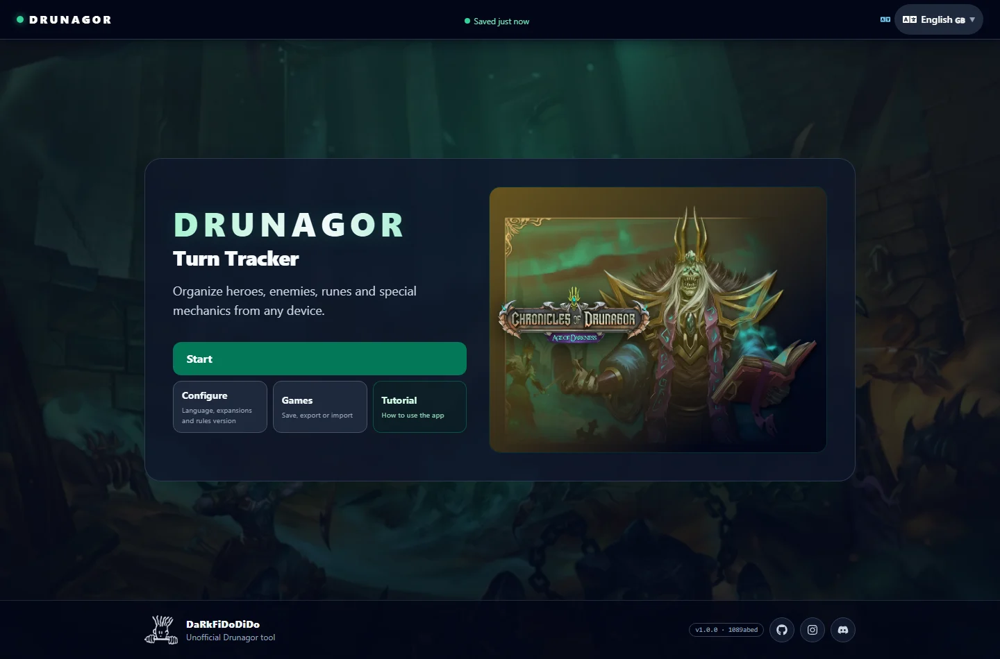

### What you see

- **Continue game**: only appears when a session is saved in this browser.
- **Start**: resets the board and keeps your configuration.
- **Configure**: language, campaign, expansions and rules.
- **Games**: save, load, export and import.
- **Tutorial**: the short built-in guide.
- **Language selector** in the top-right corner.

### First-time steps

1. Press **Configure**.
2. Enable the expansions you own.
3. Choose the rules version.
4. Return home.
5. Press **Start**.
6. Choose campaign, heroes, roles and enemies.
7. Confirm to enter the board.

> **Suggested screenshot:** home screen with arrows pointing to Configure, Games, Tutorial and the language selector.

---

## 5. Configuring the environment

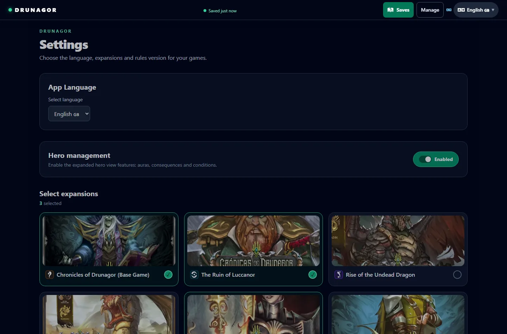

### 5.1 Language and hero management

- Change the language from the top bar.
- **Hero management** enables or disables advanced hero editing.
- Settings are remembered on this device.

### 5.2 Expansions

Each expansion appears as a card with image, icon and name:

- **Green border and ✓**: active.
- **Gray border**: inactive.
- **Dimmed card**: unavailable.

Active expansions determine:

- Available heroes.
- Available enemies and commanders.
- Rune and incursion cards.
- Visible scenes.
- Special decks.

### 5.3 Rules version

Choose a specific version or leave **Automatic**. If Apocalypse and 1.5 conflict, a warning appears.

### 5.4 Games from settings

The **Games** section opens the same save panel as `/saves`, without leaving settings.

> **Suggested screenshot:** one active and one inactive expansion, with callouts for the green check and the rules warning.

---

## 6. Creating a game step by step

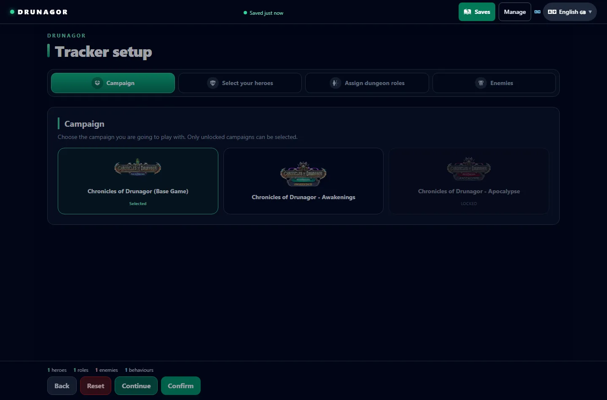

Game creation has **four steps**:

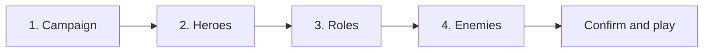

### Step 1 — Campaign

Choose the box you are playing:

- Chronicles of Drunagor (base game).
- Chronicles of Drunagor - Awakenings.
- Chronicles of Drunagor - Apocalypse, when available.

Only unlocked campaigns can be selected.

### Step 2 — Heroes

- Select **up to 5 heroes**.
- Search filters by name.
- Sort by **class** or **name**.
- Heroes are grouped by class with icon and color.
- Selected heroes have a green border.

If you try to add a sixth hero, the app warns you and does not add it.

### Step 3 — Roles

Every hero must have a dungeon role before continuing.

- Roles sharing the same board position are incompatible.
- Assigning one frees the opposite role if it was occupied.
- You may leave a hero without a role while editing, but you cannot confirm.

### Step 4 — Enemies

You can configure:

- Specific enemies.
- Quick selection by expansion.
- Random enemies.
- Allowed colors.
- Allowed behaviors: Standard, Alternative, Complex.

This enemy selection is a **candidate pool** for random summons; it does not mean every enemy is already on the board.

### Confirm

**Confirm** validates:

- At least one hero.
- Every hero has a role.
- Enemies and behaviors are valid.

If something is missing, the app moves you to the right step and shows a message.

> **Suggested screenshot:** the four header steps, active step highlighted, and the summary at the bottom.

---

## 7. Board anatomy

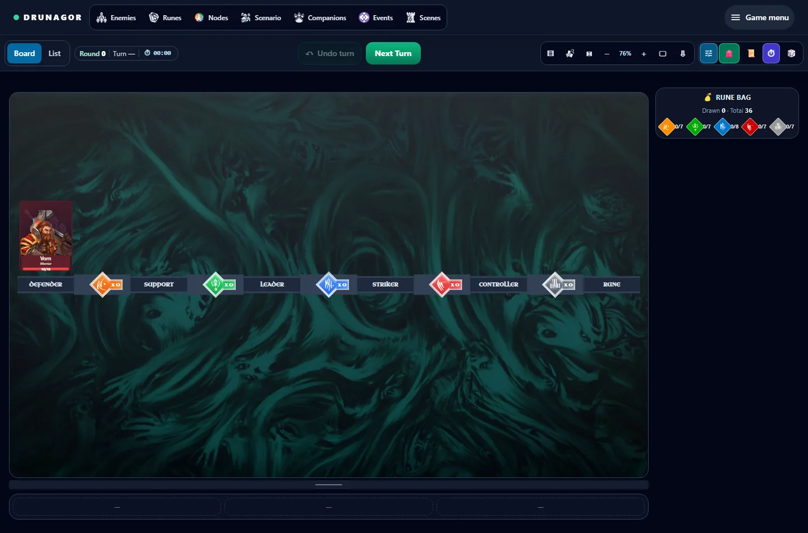

### 7.1 Top menu bar

| Menu | Purpose |
|---|---|
| **Enemies** | Add random or manual enemies, commanders, bosses and overlords |
| **Runes** | Rune cards, bag, track, manifest and mechanics |
| **Nodes** | Stacks, nodes, areas, generation points, keys and rescue |
| **Scenario** | Scenario monster, incursion and defense |
| **Companions** | Companions, pets and followers |
| **Events** | Surprises, special decks and mechanics |
| **Scenes** | Chapters grouped by expansion |
| **Game menu** | Saves, settings, camp, sequential adventure and restart |

### 7.2 Board toolbar

- **Board / List**: switch views.
- **Round / Turn / timer**: current turn information.
- **Undo turn**: return to the previous turn.
- **Next Turn**: advance initiative.
- **Density**: compact cards.
- **Simplified view**: enemies as compact tokens.
- **Overlap**: reduce spacing between cards.
- **Zoom**: zoom the board in or out.
- **Presentation mode**: hide part of the interface.
- **Panels below**: move side panels below.
- **Track controls**: show or hide controls.
- **Rune Bag**: quick access to bag status.
- **History / Turns / Dice**: lookup tools.

### 7.3 Main area

- The **central bar** is the initiative line.
- Hero and enemy cards stack above or below according to their position.
- The **active turn** is highlighted with an arrow and border.
- Top and bottom stacks adapt independently.
- The **boss banner** appears above the board when a boss is active.
- **Mechanic notices** stack directly above the board.

### 7.4 Side panel

- **Rune Bag**: drawn, total and available colors.
- Area counters and controls.
- Access to history and other panels.

### 7.5 Bottom area

- **Current turn** and **Next**.
- Turn carousel.
- Timer and round controls.

> **Suggested screenshot:** board with one hero, two enemies, one rune and the boss banner; number menus, toolbar, stacks, bag and carousel.

---

## 8. The game loop

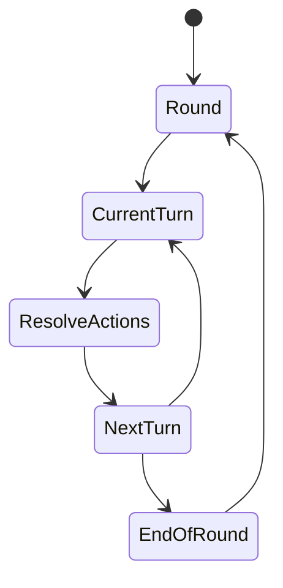

### 8.1 Start a round

When you enter the board:

- The round starts at the first valid position.
- The timer starts when there is an active turn.
- The bottom carousel shows the current and next turn.

### 8.2 Resolve the turn

During the turn:

1. Identify the **current turn** in the carousel or arrow.
2. Apply the actions and conditions at the table.
3. Use menus to add enemies, runes, cards or changes.
4. Update health, conditions and cubes from the cards.
5. Check active notices before moving on.

The app **does not resolve combat or dice**; it records state so the table does not lose track.

### 8.3 Next turn

Press **Next Turn**:

- The marker advances to the next active entity.
- Extra turns in the queue are respected.
- After the last entity, a new round begins.

### 8.4 Undo

**Undo turn** returns to the previous initiative cursor state. It is useful when you press Next by mistake.

### 8.5 Timer

- Turn time is shown as `mm:ss`.
- It turns red after **5:00**.
- History shows accumulated hero times.

### 8.6 History

History stores up to **300 events**:

- Enemy summons.
- Cards and runes.
- Relevant changes.
- Scenario events.

You can filter by type or search text.

> **Suggested screenshot:** three shots: current turn, next turn and new round, with arrows to the board cursor and timer.

---

## 9. Support menus

### 9.1 Enemies

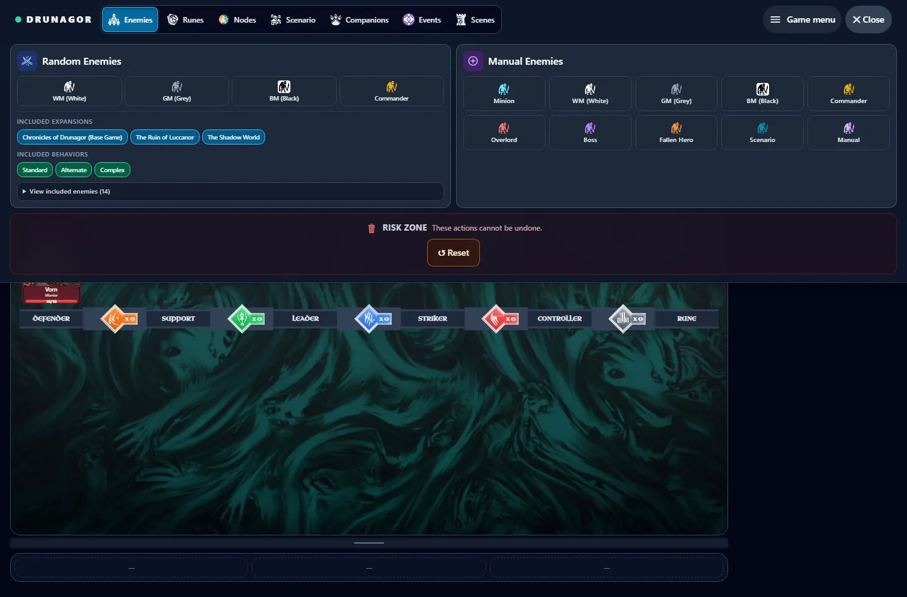

Two main areas:

#### Random enemies

- Choose color and behavior.
- The app picks a compatible enemy from active expansions.
- Random enemies form a candidate pool.

#### Manual enemies

Search and filter by:

- Color: white, gray, black, commander, boss, overlord, fallen hero.
- Category: rookie, soldier, veteran, champion, scenario, etc.
- Expansion.
- Name.

When an enemy is added:

- It is placed in a free board position.
- It receives a color ring.
- It is recorded in history.

#### Commanders

When adding a commander, the app asks for the **PC value** and allows a manual deck. It then places attack cards.

#### Bosses

Bosses may ask for:

- **Trauma cubes**.
- **Curse cubes**.

The resulting health uses the boss's own values. Some bosses have additional consequence questions.

#### Double-faced cards

Some enemies have face A and B. Click the card to open its sheet and flip it. Face B may change values and abilities.

#### Risk zone

At the end of the menu, destructive actions require confirmation:

- Reset enemies.
- Clear enemies from the board.

---

### 9.2 Runes

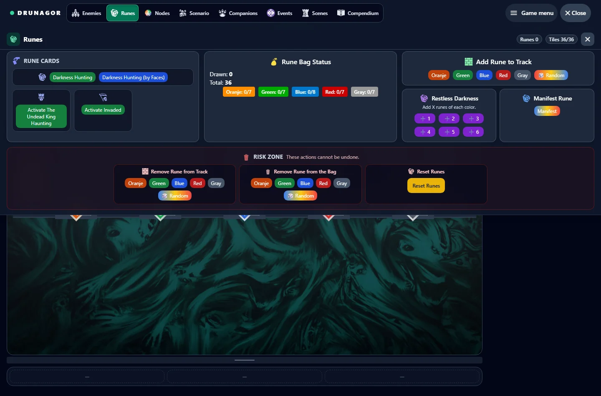

The menu has:

1. **Rune cards**.
2. **Bag status**.
3. **Add to track / manifest / Stirring Darkness**.
4. **Risk zone**.

#### Rune cards

Includes cards such as:

- Darkness Hunting.
- Wermunggdir's Assault.
- The Undead King Haunting.
- Invaded.
- Awakenings runes.

Each card can be added by face A or B when available. The app prevents incompatible duplicates where appropriate.

#### Bag and track

- **Drawn**: tiles already taken from the bag.
- **Total**: initial available total.
- Each color shows remaining tiles.

#### Add rune to track

Add a tile of a specific color or a random tile.

#### Stirring Darkness

Add X runes of each color to the track at once. You can choose from 1 to 6; if a color does not have enough tiles in the bag, the available ones are added.

#### Manifest

Place a manifested rune through the app flow.

#### Rune mechanics

- **Haunting**: activates the Undead King mechanic.
- **Invaded**: activates the invasion mechanic.
- **Host Monster**: passive rune draw when defeating enemies.

These mechanics show a notice above the board and only appear in their campaign.

#### Risk zone

- Remove rune from track.
- Remove rune from bag.
- Reset runes.

Destructive actions require confirmation.

---

### 9.3 Nodes and areas

The **Nodes** menu groups:

- **Rune stacks**.
- **Concentrated stacks / fog**.
- **Darkness Nodes**.
- **Area control**:
  - Barricades.
  - Spawn points.
  - Rune keys.
  - Villager rescue.

Each panel lets you add, activate, remove or resolve. The final risk zone resets the menu mechanics.

---

### 9.4 Scenario

The **Scenario** menu contains:

- **Scenario monster**: choose one available for the campaign.
- **Monster Incursion**: add the card and its effects.
- **Defense**: add the defense card with a time marker.

The monster selection affects some incursion cards. If a card needs a monster and none is selected, the button is disabled.

The final **risk zone** removes:

- The scenario monster.
- Incursion cards.
- Defense cards.

> **Suggested screenshot:** Scenario menu with a selected monster, enabled incursion card and risk zone.

---

### 9.5 Companions

The **Companions** menu lets you:

- Add companions.
- Add pets.
- Add followers.
- Choose the active hero they are attached to.
- Open their sheet for health, conditions and abilities.
- Reset health and conditions.

On the board, the companion appears **behind its hero** and joins initiative order. Pets use the same card system.

---

### 9.6 Events and special mechanics

This menu activates mechanics that do not belong to a specific scene:

- **Buried Surprise**.
- **Host Monster**.
- **Eternal Darkness**.
- **Awakenings special decks**:
  - Corrupt Ship PS.
  - Swan Ship PS.
  - Siege of Limiternia.
  - Eradren Surprise.

Mechanics display a persistent notice above the board. Some are only available in their campaign; for example, Eternal Darkness belongs to the base game.

> **Suggested screenshot:** Events menu with Eternal Darkness active and its notice above the board.

---

### 9.7 Scenes

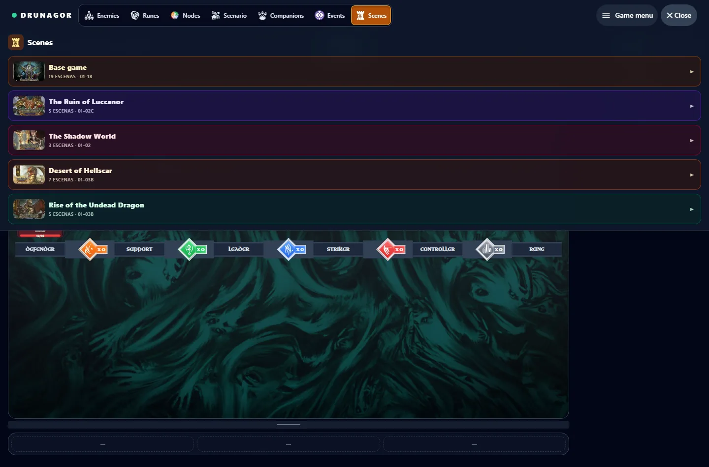

Scenes are grouped by **game or expansion**:

- Base game.
- Awakenings.
- Luccanor.
- The Dark World.
- Desert of Hellscar.
- Rise of the Undead Dragon.
- Future expansions.

Each group:

- Is **collapsed by default**.
- Shows image, name, scene count and chapter range.
- Expands when you click its header.
- Sorts scenes by chapter.

#### Activate a scene

Click a scene to apply its setup. Depending on the scene, the app may:

- Reset enemies, runes and board.
- Preserve track runes.
- Remove disallowed companions.
- Add enemies based on hero count.
- Add rune or incursion cards.
- Add an active Fog Node.
- Activate a boss.
- Ask about conditions, trauma or curses.

#### Sequential scenes

Some scenes are designed to be played in sequence:

- They keep track runes.
- They clear disallowed conditions.
- They keep trauma and curses.
- They reset enemies or other elements.

The app shows a summary after applying the scene.

#### Lettered scenes

Scenes with letters (`01b`, `02b`, `02c`...) are usually continuations. Their behavior may vary: some do not reset the board, others do. Always check the summary and confirmations.

> **Important:** activate a scene only when you are about to start that chapter. Setup changes the current state.

---

### 9.8 Game menu

The **Game menu** brings together:

| Option | Purpose |
|---|---|
| **Games** | Save, load, export and import |
| **Music** | Music controls, when available |
| **View other campaigns** | Show another box's content without changing the game |
| **Home** | Return to the home screen |
| **Back to settings** | Change language, expansions or rules |
| **Camp** | Store shared objects |
| **Camp Phase** | Clear the board, heal the group and save |
| **Sequential Adventure** | Prepare the next chapter while keeping resources |
| **Restart game** | Grouped restart options |

---

## 10. Heroes, conditions and resources

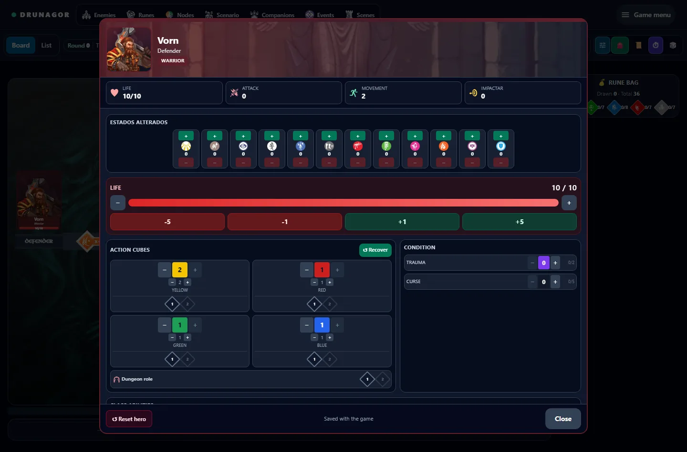

Click a hero card to open its expanded sheet. There you can view and change:

- **Current and maximum health**.
- **Conditions**.
- **Action cubes**.
- **Trauma and curses**.
- **Skills and abilities**.
- **Equipment and items**.
- **Class resources**: Concentration, Ki, Rage, Life Fruit.

### Common conditions

| Condition | Purpose |
|---|---|
| **Shield** | Stackable protection |
| **Ki** | Monk resource |
| **Concentration** | General resource |
| **Life Fruit** | Druid resource |
| **Rage** | Barbarian resource |
| **Entropy** | Special resource |
| **Poison, Burn, Bleed** | Damage conditions |
| **Knockdown, Stun, Slow** | Control conditions |
| **Stealth, Fragile, Restriction** | Defensive or limiting states |

Conditions appear next to hero health and in the expanded sheet.

### Action cubes

Cubes are spent and recovered during play. The app lets you mark and review them. Camp or hero reset restores them to maximum.

### Companions and followers

- Added from **Companions**.
- Placed behind their hero.
- Have their own health, conditions and sheet.
- Followers use the same flow.
- The roster is filtered by campaign: the base game shows no followers, while **Awakenings** and **Apocalypse** each have six. Previewing other campaigns lets you browse all twelve.
- In Apocalypse, **Robin Rising** lets you choose between the **Wounded** and **Healthy** profiles; the rest have a single profile.
- Names, epithets, profiles and abilities change with the interface language.

---

## 11. Enemies, commanders and bosses

Click an enemy card to open its sheet. There you can:

- View health, attack, movement and immunities.
- Change health.
- Add or remove conditions.
- Flip double-faced cards.
- Remove the enemy from the board.

### Categories

| Category | App behavior |
|---|---|
| **Rookie / Soldier / Veteran / Champion** | Normal enemies; stack on the board |
| **Commander** | Asks for PC and places attack cards |
| **Overlord** | Uses its own deck |
| **Boss** | Highlighted banner, trauma/curse questions and boss cards |
| **Fallen hero** | Special defeated-hero card |
| **Scenario** | Placed from Scenario menu or a scene |

### Bosses with questions

When summoning a boss, the app may ask for removed cubes:

- **Trauma**: increases health according to the boss value.
- **Curse**: increases health according to the boss value.

Implemented examples:

- **Wermunggdir**: +10 per trauma, +2 per curse.
- **Aral'hezec**: +5 per trauma, +1 per curse.

### Boss banner

When a boss is active, a large card appears above the board with:

- Portrait fitted to the frame.
- Name.
- Health and bar.
- Immunities.
- Access to its sheet.
- Compact/expand button.

### Chained attacks

Some boss cards include “perform all attacks”. The app shows the calculated attacks based on the card rune, for example:

- Dragon Breath.
- Wing Strike.
- Tail Swipe.

The X value is calculated automatically.

> **Suggested screenshot:** boss sheet with portrait, health bar, immunities and attack dropdown.

---

## 12. Runes, darkness and tile economy

The app distinguishes three areas:

1. **Bag**: available tiles.
2. **Board/track**: drawn or placed tiles.
3. **Stacks, nodes and areas**: tiles grouped for specific mechanics.

### Usage rules

- Adding a rune to the track removes a tile from the bag.
- Some actions return tiles; others discard them.
- Track runes can be preserved between sequential chapters.
- Rune cards do not always return to the bag when removed.
- The bag shows per-color totals so mismatches are easy to spot.

### Stacks and nodes

- **Rune stack**: rune group that can be activated, returned or used in close combat.
- **Concentrated stack / fog**: node with runes and area effects.
- **Darkness Node**: later-campaign mechanic.

### Eternal Darkness

When active:

- All spaces are under Darkness.
- Summoned enemies gain **+2 Attack**.
- Attack is shown as original/modified, for example `5/7`.

It only appears in the base game.

---

## 13. Saves, export and import

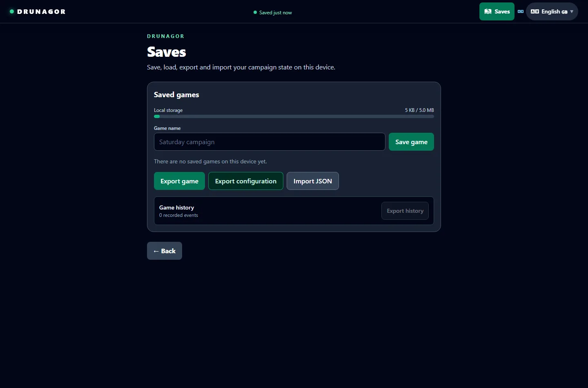

### Autosave

The app automatically saves state in `localStorage`:

- Board.
- Turn and round.
- Enemies.
- Runes and tiles.
- Heroes and conditions.
- Camp: items, party name and story record.
- Followers recruited at camp.

### Manual saves

- Save up to **10 games** with a name.
- Each full save includes configuration, board state, story record and recruited followers.
- **Configuration only** keeps the party name and story record (they live inside configuration), but not the follower roster.
- The top indicator shows used storage.

### Export

Three scopes:

| Export | Content |
|---|---|
| **Full game** | Configuration + board + state + recruited followers |
| **Configuration only** | Campaign, expansions, heroes, roles, enemies, party name and story record |
| **Track only** | Current game state, including recruited followers |

### Import

1. Press **Import JSON**.
2. Select the file.
3. The app validates and sanitizes data against current catalogs.
4. Unknown entries are discarded.
5. Saves from schema versions 1–3 remain compatible; older saves without followers load without them.
6. The save is applied. A full game also restores the recruited follower roster.

### Limitations

- No device synchronization.
- Clearing browser data deletes unsaved games.
- Space is limited; the app warns near the limit.
- **Configuration only** does not include recruited followers: use **full game** to carry everything.

> **Tip:** export a copy before a boss, a campaign change or an important update.

---

## 14. Restart game

Restart options are grouped to avoid too many choices:

| Option | What it resets |
|---|---|
| **Runes** | Runes, tiles, stacks, nodes and active mechanics |
| **Heroes, companions, pets and followers** | Health, conditions, resources and cubes |
| **Enemies** | Enemies, attack cards and scenario monster. Enabled by default |
| **Events, special decks and villagers** | Surprises, decks, cannons, Clear Vision and villagers |

Always reset:

- Turn.
- History.
- Turn session.
- Generation points.
- Magic cannons.
- Siege and Flickering Boar.

---

## 15. Camp and sequential adventure

### Camp

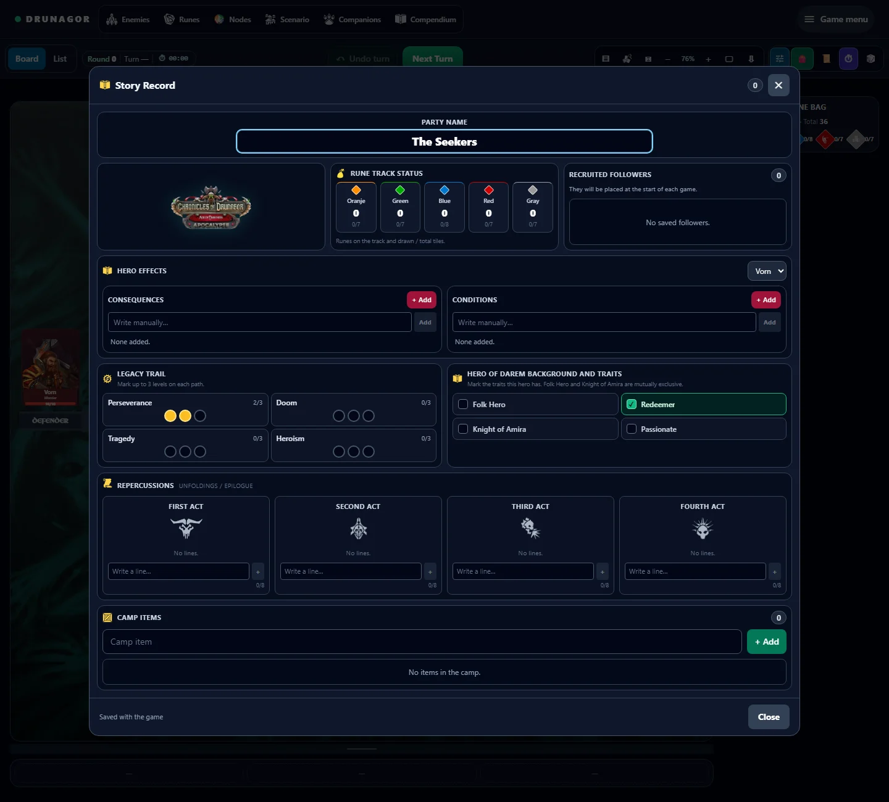

**Camp** stores shared group objects. It is a shared storage, not a shop.

The dialog is ordered from top to bottom: centered party name; campaign story record, rune track and recruited followers; hero effects split into consequences and conditions; and camp objects at the end. **Apocalypse** also shows the **Legacy Trail** (four paths in a 2 × 2 grid, three levels each), the **Hero of Darem** traits (Folk Hero and Knight of Amira are mutually exclusive) and **Repercussions**, with one column per act for custom lines.

The top row adapts to the campaign: **Awakenings** and **Apocalypse** show **Recruited Followers**; Apocalypse always shows it, even when empty, because followers will be added later. The base game hides that block.

### Camp Phase

Camp Phase:

- Clears the board.
- Heals the group.
- Saves the game.
- Keeps hero and role configuration available.

### Sequential Adventure

Sequential Adventure:

- Preserves resources.
- Replaces runes.
- Saves state.
- Lets you continue to the next chapter.

Use it between chapters when you want to keep progression without starting over.

---

## 16. Visuals, accessibility and performance

### Views

- **Board**: cards stacked around the central bar.
- **List**: compact rows with expandable details.
- **Simplified view**: enemies as small tokens.
- **Presentation mode**: hides secondary controls.

### Visual settings

- **Zoom**: change board size.
- **Density**: reduce card size and spacing.
- **Overlap**: bring stack cards closer.
- **Panels below**: reorganize on narrow screens.
- **Track controls**: hide the toolbar.

### Accessibility

- The app uses text in addition to color.
- Menus have ARIA labels.
- Buttons expose `aria-pressed` or `aria-expanded`.
- Focus remains visible.
- Language can be changed on the fly.

> **Suggested screenshot:** side-by-side normal, compact and simplified views.

---

## 17. Recommended usage strategies

These are strategies for using the app, not in-game tactics:

1. **Configure once**: expansions and rules version.
2. **Export** before a boss or chapter change.
3. **Use named saves** for “before boss”, “camp” and “end of session”.
4. **Activate a scene** only when starting the chapter.
5. **Add the boss last** during scene setup.
6. **Use manual enemies** for specific creatures you do not want to randomize.
7. **Check the bag** after every sequential scene.
8. **Use simplified view** when many enemies are on the board.
9. **Use presentation mode** on a shared screen.
10. **Export history** if you want a session log.

---

## 18. Common problems

### “I cannot enter the board”

`/init` requires at least one hero. If there are no heroes, the app redirects to setup.

### “I lost my game”

Check:

1. Same browser and device.
2. Site data has not been cleared.
3. Import an exported JSON if available.

### “I cannot see a card or enemy”

- Check active expansions.
- Check the selected campaign.
- Check manual selector filters.
- In Scenes, expand the correct expansion group.

### “A notice is not visible”

Persistent notices stack above the board. If there are several, they display vertically. Scroll to the top of the board if there is a lot of content.

### “The rune bag does not add up”

- Check drawn tiles.
- Check whether a scene consumed runes for stacks or spawn points.
- Use the Runes risk zone only when you want to reset the economy.

### “An imported save does not load”

The app validates data. A file from another version may contain unknown entries, which are discarded. Export again from the current version.

### “The app is slow with many cards”

- Enable simplified view.
- Reduce density.
- Lower zoom.
- Close open menus.
- On mobile, use List view.

---

## 19. Quick checklist

### Before the session

- [ ] Correct expansions.
- [ ] Correct rules version.
- [ ] Heroes and roles assigned.
- [ ] Enemies and behaviors configured.
- [ ] Recent save/export.

### Starting a chapter

- [ ] Correct scene.
- [ ] Confirm setup summary.
- [ ] Review track runes.
- [ ] Review enemies and boss.
- [ ] Review active notices.

### During the turn

- [ ] Current turn identified.
- [ ] Health and conditions updated.
- [ ] Cubes and resources updated.
- [ ] Timer visible.
- [ ] Next Turn only after the table finishes.

### At the end

- [ ] Save with a name.
- [ ] Export a copy.
- [ ] Note issues in history.
- [ ] Leave state ready to continue.

---

## 20. Figure and screenshot guide

| Figure | File | What it shows | Recommended annotations |
|---|---|---|---|
| 1 | `tutorial/assets/en/01-start.webp` | Home | Continue, Configure, Games, Tutorial, language |
| 2 | `tutorial/assets/en/02-settings.webp` | Expansions | Active/inactive, rules version, saves |
| 3 | `tutorial/assets/en/03-setup.webp` | Setup wizard | Steps, campaign, heroes, roles, enemies |
| 4 | `tutorial/assets/en/04-board.webp` | Board | Menus, toolbar, stacks, bag, carousel |
| 5 | `tutorial/assets/en/05-scenes.webp` | Scenes | Collapsed groups, images, chapter ranges |
| 6 | `tutorial/assets/en/06-runes.webp` | Runes | Cards, bag, track, bulk, risk zone |
| 7 | `tutorial/assets/en/07-enemies.webp` | Enemies | Random, manual, filters, risk zone |
| 8 | `tutorial/assets/en/08-hero-card.webp` | Hero sheet | Health, conditions, cubes, trauma, curses |
| 9 | `tutorial/assets/en/09-saves.webp` | Saves | Save, export, import, history |
| 10 | `tutorial/assets/en/10-camp.webp` | Camp | Party, story, runes, followers, Legacy, Daren, Repercussions |

### Additional screenshots recommended

- Enemy sheet with immunities and flip button.
- Boss banner with portrait and immunities.
- Scenario menu with monster, incursion and defense.
- Restart dialog with its four groups.
- Camp Phase screen.

### Recommended diagrams

- Onboarding and setup flow.
- Turn loop.
- Scene decision tree (normal, sequential, lettered event).
- Board menu map.
- Color and icon legend.

---

## 21. Glossary

| Term | Definition |
|---|---|
| **Track** | Initiative board with 11 positions |
| **Slot** | Board position |
| **Round** | One complete pass through initiative order |
| **Turn** | Activation of one entity |
| **Initiative** | Order in which heroes, enemies and runes act |
| **Rune** | Color tile drawn from the bag |
| **Bag** | Available tiles |
| **Track** | Runes placed on the initiative board |
| **Stack** | Grouped runes |
| **Node** | Darkness/fog group with an area effect |
| **Companion** | Creature attached to a hero |
| **Pet** | Companion of type pet |
| **Follower** | Ally following a hero |
| **PC** | Commander power value |
| **Scene** | Automatic chapter setup |
| **Campaign** | Main box: base, Awakenings or Apocalypse |
| **Expansion** | Additional campaign content |

---

## 22. Closing

You now know the full flow:

1. Configure.
2. Create the game.
3. Prepare the table.
4. Play turns.
5. Manage runes, enemies, heroes and scenario.
6. Save and export.

The best way to learn is a test game with one hero, one enemy and one rune. Once you master that loop, add companions, bosses and scenes.

> **Golden rule:** if something does not add up, review the state before restarting. The app keeps a lot of context, and fixing is usually faster than starting over.
