# Tutorial completo de Drunagor Turn Tracker

> **Guía para nuevos usuarios · Edición 2026**  
> Esta guía explica cómo usar la aplicación, no sustituye al reglamento de *Chronicles of Drunagor*. La app registra el estado de la partida y automatiza parte de la preparación; las reglas, decisiones y excepciones siguen siendo responsabilidad de la mesa.

> **English:** [Read the English tutorial](TUTORIAL.en.md)

---

## 1. Qué es esta aplicación

**Drunagor Turn Tracker** es un compañero digital para dirigir partidas de *Chronicles of Drunagor*. Reúne en una sola pantalla:

- El **orden de iniciativa**.
- El **turno actual**, la ronda y el cronómetro.
- Héroes, compañeros, mascotas y seguidores.
- Enemigos, comandantes, señores supremos, jefes y héroes caídos.
- Runas, bolsa, medidor, pilas, nodos y áreas.
- El monstruo de escenario y sus cartas de incursión y defensa.
- Estados alterados, inmunidades, vida y cubos de acción.
- Escenas de campaña y preparación automática de capítulos.
- Guardados locales, exportación e importación.

### Lo que debes saber desde el primer minuto

| Concepto | Significado |
|---|---|
| **Local-first** | Todo se guarda en el navegador. No hay cuenta ni servidor. |
| **Sin instalación** | Funciona como página web; puede usarse en móvil, tablet u ordenador. |
| **No oficial** | Es una herramienta personal, no un producto oficial del juego. |
| **Datos privados** | Las partidas no se sincronizan entre dispositivos salvo que exportes e importes el JSON. |
| **La app no decide por ti** | No valida todas las reglas del juego; registra y ayuda a preparar la mesa. |

> **Consejo:** antes de una sesión importante, exporta la partida. El almacenamiento del navegador puede borrarse al limpiar datos o cambiar de dispositivo.

---

## 2. Mapa general del flujo

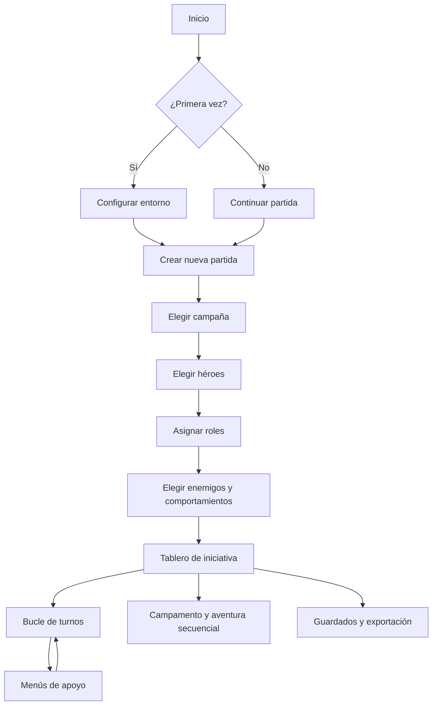

### Ruta recomendada para empezar

1. **Configurar entorno**: idioma, campaña, expansiones y reglas.
2. **Crear partida**: héroes y roles.
3. **Preparar la mesa**: enemigos, runas, escenario y escenas.
4. **Jugar los turnos** con el tablero.
5. **Guardar o exportar** antes de cerrar.

---

## 3. Conceptos que debes conocer antes de tocar el tablero

### 3.1 Campaña, caja y expansión

La aplicación distingue tres niveles:

| Nivel | Qué es | Dónde se elige |
|---|---|---|
| **Campaña / caja** | Juego base, Despertar o Apocalipsis | Configuración y primer paso de la partida |
| **Expansión** | Contenido adicional dentro de una campaña | Configuración |
| **Escena / capítulo** | Preparación concreta de una aventura | Menú **Escenas** |

Las expansiones activas filtran héroes, enemigos, cartas y escenas. Si falta una expansión, su contenido no aparece en los selectores normales.

> **Ver contenido de otras campañas** permite mirar contenido de otra caja sin cambiar la partida. No convierte esa campaña en la activa.

### 3.2 Reglas 1.5 y 2.0

En **Configuración → Versión de reglas** puedes elegir:

- **Automático**: usa 2.0 si hay expansiones de Apocalipsis activas; si no, 1.5.
- **1.5**: reglamento original.
- **2.0**: preparado para Apocalipsis.

Si fuerzas 1.5 con expansiones de Apocalipsis activas, la app muestra un aviso.

### 3.3 El track de iniciativa

El track es el corazón de la app. Tiene **11 posiciones**:

- Posiciones de rol: Defensor, Apoyo, Líder, Agresor y Controlador.
- Posiciones de runa: una por cada color.
- Una posición final para la runa genérica.

Las cartas se apilan **por encima y por debajo** de la barra central. La línea central se ajusta de forma independiente según el espacio real que necesitan las pilas de arriba y de abajo.

### 3.4 Códigos visuales

| Código / icono | Significado |
|---|---|
| **MB** | Monstruo Blanco |
| **MG** | Monstruo Gris |
| **MN** | Monstruo Negro |
| **Comandante** | Enemigo con baraja propia y valor de PC |
| **Jefe** | Enemigo destacado; aparece en el banner superior |
| **Señor Supremo** | Enemigo especial con cartas propias |
| **Héroe caído** | Carta especial de héroe derrotado |
| **Corona / calavera** | Jefe o mecánica de jefe |
| **Escudo circular** | Inmunidad |
| **Ficha de tiempo** | Contador de tiempo de una carta o defensa |
| **Punto de color** | Color de runa o generación |

> No dependas solo del color: la app añade iniciales, iconos y etiquetas para que el mismo estado se reconozca también sin distinguir colores.

---

## 4. Primer inicio

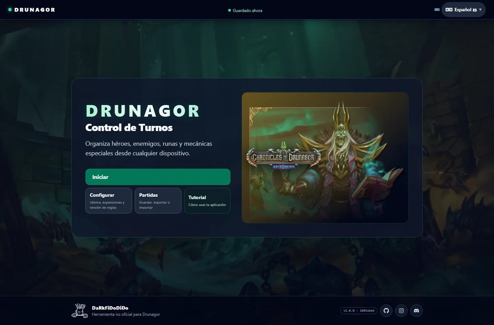

### Qué ves

- **Continuar partida**: solo aparece si hay una sesión guardada en este navegador.
- **Iniciar / Nueva partida**: reinicia el track y conserva tu configuración.
- **Configurar**: idioma, campaña, expansiones y reglas.
- **Partidas**: guardar, cargar, exportar e importar.
- **Tutorial**: guía breve integrada.
- **Selector de idioma** en la esquina superior derecha.

### Qué hacer la primera vez

1. Pulsa **Configurar**.
2. Activa las expansiones que tengas.
3. Elige la versión de reglas.
4. Vuelve al inicio.
5. Pulsa **Iniciar**.
6. Elige campaña, héroes, roles y enemigos.
7. Confirma para entrar al tablero.

> **Captura sugerida:** la pantalla de inicio con flechas sobre “Configurar”, “Partidas”, “Tutorial” y el selector de idioma.

---

## 5. Configurar el entorno

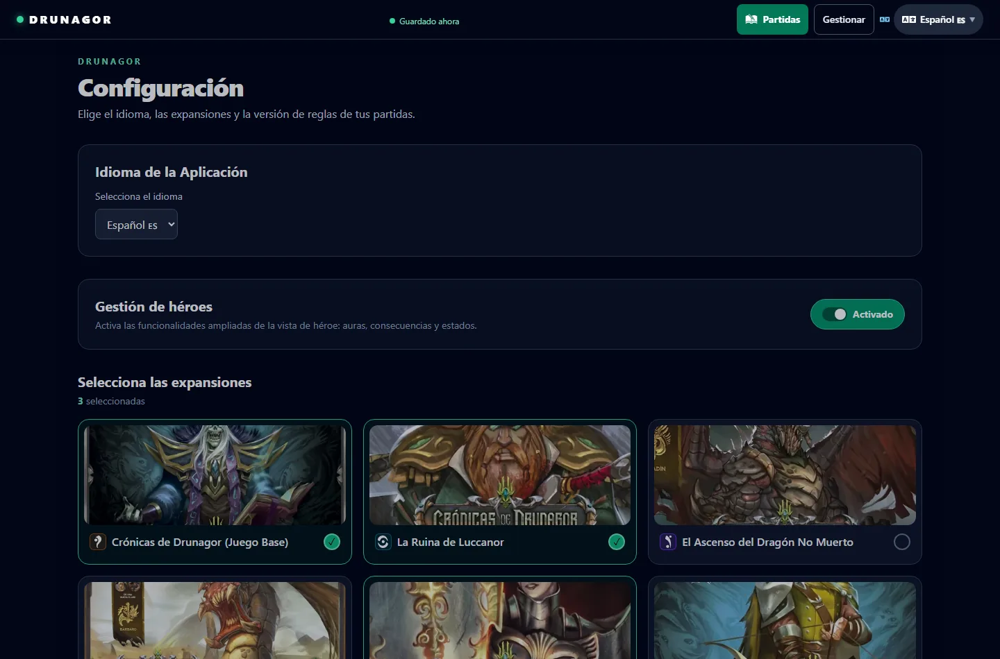

### 5.1 Idioma y gestión de héroes

- El idioma se cambia desde la barra superior.
- **Gestión de héroes** permite activar o desactivar la edición avanzada de héroes.
- La configuración se recuerda en este dispositivo.

### 5.2 Expansiones

Cada expansión aparece como una tarjeta con imagen, icono y nombre:

- **Borde verde y marca ✓**: activa.
- **Borde gris**: inactiva.
- **Tarjeta atenuada**: expansión no disponible.

Las expansiones activas determinan:

- Héroes disponibles.
- Enemigos y comandantes disponibles.
- Cartas de runa e incursión.
- Escenas visibles.
- Mazos especiales.

### 5.3 Versión de reglas

Puedes escoger una versión concreta o dejar **Automático**. Si hay una incoherencia entre Apocalipsis y 1.5, aparece un aviso.

### 5.4 Partidas desde configuración

El desplegable **Partidas** abre el mismo panel de guardados que la pantalla `/saves`, sin salir de la configuración.

> **Captura sugerida:** una expansión activa y otra inactiva, con una llamada a la marca verde y al aviso de reglas.

---

## 6. Crear una partida paso a paso

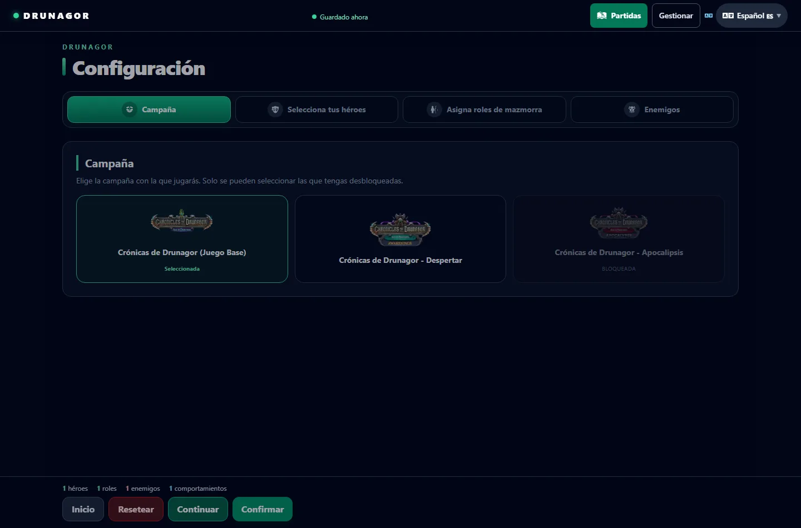

La creación de partida tiene **cuatro pasos**:

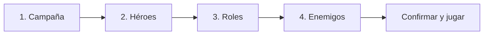

### Paso 1 — Campaña

Elige la caja con la que vas a jugar:

- Crónicas de Drunagor (juego base).
- Crónicas de Drunagor - Despertar.
- Crónicas de Drunagor - Apocalipsis, si está disponible.

Solo se pueden elegir campañas desbloqueadas.

### Paso 2 — Héroes

- Puedes seleccionar **hasta 5 héroes**.
- La búsqueda filtra por nombre.
- Puedes ordenar por **clase** o por **nombre**.
- Los héroes se agrupan por clase con su icono y color.
- Un héroe seleccionado queda marcado con borde verde.

Si intentas añadir un sexto héroe, la app avisa y no lo añade.

### Paso 3 — Roles

Cada héroe debe tener un rol de mazmorra antes de continuar.

- Los roles que comparten la misma posición del track son incompatibles.
- Al asignar uno, se libera el rol opuesto si estaba ocupado.
- Puedes dejar un héroe sin rol mientras editas, pero no podrás confirmar.

### Paso 4 — Enemigos

Puedes configurar:

- Enemigos concretos.
- Selección rápida por expansión.
- Enemigos aleatorios.
- Colores permitidos.
- Comportamientos permitidos: Estándar, Alternativo, Complejo.

La selección de enemigos sirve como **bolsa de candidatos** para las invocaciones aleatorias; no significa que todos estén ya en el tablero.

### Confirmar

El botón **Confirmar** valida:

- Al menos un héroe.
- Todos los héroes con rol.
- Enemigos y comportamientos válidos.

Si falta algo, la app te lleva al paso correspondiente y muestra un mensaje.

> **Captura sugerida:** los cuatro pasos de la cabecera, con el paso activo resaltado y el resumen inferior.

---

## 7. Anatomía del tablero

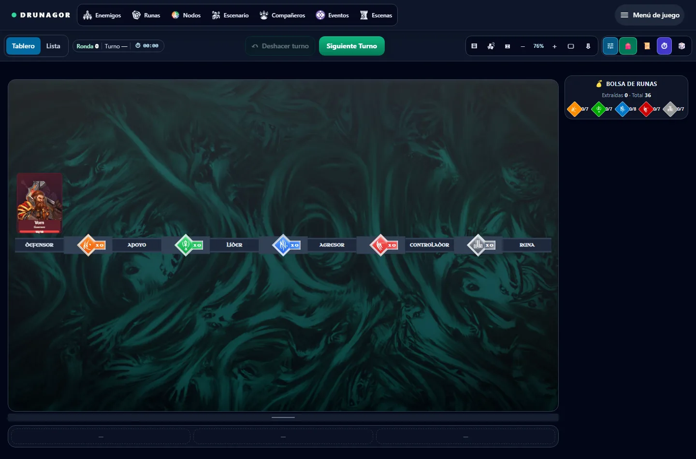

### 7.1 Barra superior de menús

De izquierda a derecha:

| Menú | Para qué sirve |
|---|---|
| **Enemigos** | Añadir enemigos aleatorios o manuales, comandantes, jefes y señores supremos |
| **Runas** | Cartas de runa, bolsa, medidor, manifestar y mecánicas |
| **Nodos** | Pilas, nodos, áreas, puntos de generación, llaves y rescate |
| **Escenario** | Monstruo de escenario, incursión y defensa |
| **Compañeros** | Compañeros, mascotas y seguidores |
| **Eventos** | Sorpresas, mazos especiales y mecánicas |
| **Escenas** | Capítulos agrupados por expansión |
| **Menú de juego** | Guardados, configuración, campamento, aventura secuencial y reinicio |

### 7.2 Barra del tablero

- **Tablero / Lista**: cambia la vista.
- **Ronda / Turno / cronómetro**: información del turno actual.
- **Deshacer turno**: vuelve al turno anterior.
- **Siguiente Turno**: avanza la iniciativa.
- **Densidad**: cartas más compactas.
- **Vista simplificada**: enemigos como fichas compactas.
- **Solape**: reduce la separación entre cartas.
- **Zoom**: acerca o aleja el tablero.
- **Modo presentación**: oculta parte del interfaz para mostrar la mesa.
- **Paneles debajo**: mueve los paneles laterales.
- **Controles del track**: muestra u oculta controles.
- **Bolsa de runas**: acceso rápido al estado de la bolsa.
- **Historial / Turnos / Dados**: herramientas de consulta.

### 7.3 Zona central

- La **barra central** marca la línea de iniciativa.
- Las cartas de héroe y enemigo se apilan arriba o abajo según su posición.
- El **turno activo** se señala con una flecha y un borde destacado.
- Las pilas se ajustan de forma independiente arriba y abajo.
- El **banner del jefe** aparece encima del track cuando hay un jefe activo.
- Los **avisos de mecánicas** se apilan justo encima del track.

### 7.4 Panel lateral

- **Bolsa de runas**: extraídas, total y colores disponibles.
- Contadores y controles de áreas.
- Accesos a historial y demás paneles.

### 7.5 Zona inferior

- **Turno actual** y **Siguiente**.
- Carrusel de turnos.
- Botones de control del cronómetro y la ronda.

> **Captura sugerida:** tablero con un héroe, dos enemigos, una runa y el banner del jefe; numerar menús, barra, pilas, bolsa y carrusel.

---

## 8. El bucle de juego

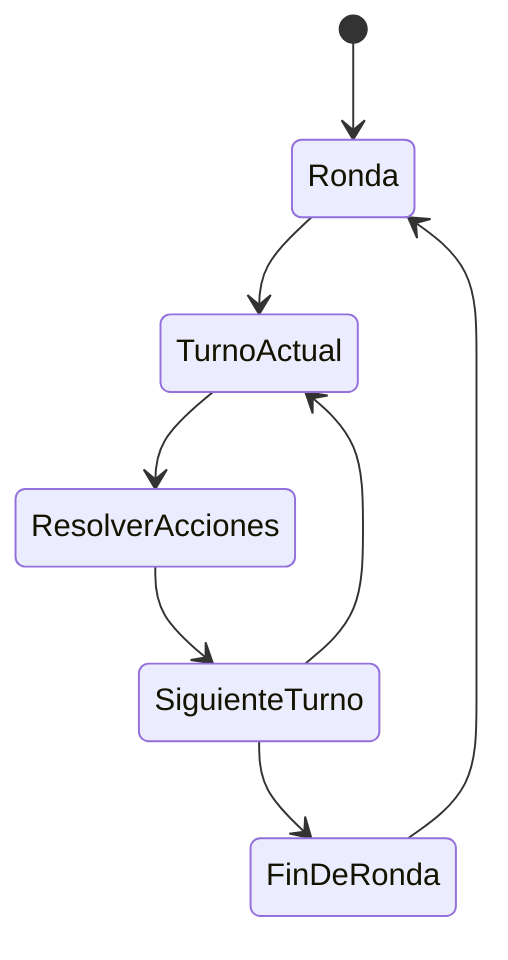

### 8.1 Iniciar una ronda

Al entrar en el tablero:

- La ronda comienza en la primera posición válida.
- El cronómetro empieza a contar cuando hay un turno activo.
- El carrusel inferior muestra el turno actual y el siguiente.

### 8.2 Resolver el turno

Durante el turno:

1. Identifica el **turno actual** en el carrusel o en la flecha del track.
2. Aplica las acciones y estados que correspondan en la mesa.
3. Usa los menús para añadir enemigos, runas, cartas o cambios.
4. Modifica vida, estados y cubos desde las fichas.
5. Comprueba los avisos activos antes de pasar.

La app **no resuelve combates ni tiradas**; registra el estado para que la mesa no pierda el hilo.

### 8.3 Pasar al siguiente turno

Pulsa **Siguiente Turno**:

- El marcador avanza a la siguiente entidad activa.
- Si hay turnos extra en cola, se respetan.
- Al terminar la vuelta, comienza una nueva ronda.

### 8.4 Deshacer

**Deshacer turno** vuelve al estado anterior del cursor de iniciativa. Es útil para corregir un “siguiente” pulsado por error.

### 8.5 Cronómetro

- El tiempo del turno se muestra en `mm:ss`.
- Cambia a rojo a partir de **5:00**.
- El historial permite consultar tiempos acumulados por héroe.

### 8.6 Historial

El historial guarda hasta **300 eventos**:

- Aparición de enemigos.
- Cartas y runas.
- Cambios relevantes.
- Eventos de escenario.

Puedes filtrar por tipo o buscar texto.

> **Captura sugerida:** secuencia de tres capturas: turno actual, siguiente turno y ronda nueva. Añadir flechas al cursor del track y al cronómetro.

---

## 9. Menús de apoyo

### 9.1 Enemigos

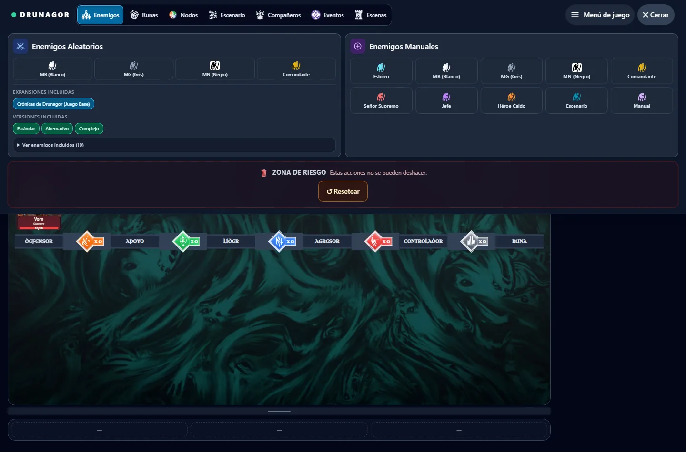

Dos zonas principales:

#### Enemigos aleatorios

- Elige color y comportamiento.
- La app escoge un enemigo compatible con las expansiones activas.
- Los enemigos aleatorios se usan como bolsa de candidatos.

#### Enemigos manuales

Permite buscar y filtrar por:

- Color: blanco, gris, negro, comandante, jefe, señor supremo, héroe caído.
- Categoría: bisoño, soldado, veterano, campeón, escenario, etc.
- Expansión.
- Nombre.

Al añadir un enemigo:

- Se coloca en una posición libre del track.
- Recibe un anillo de color.
- Se registra en el historial.

#### Comandantes

Al añadir un comandante, la app pregunta por el **valor de PC** y permite escoger una baraja manual. Después coloca sus cartas de ataque.

#### Jefes

Los jefes pueden pedir:

- **Cubos de trauma**.
- **Cubos de maldición**.

La vida resultante se calcula con los valores propios del jefe. Algunos jefes tienen preguntas adicionales de consecuencias.

#### Cartas de doble cara

Algunos enemigos tienen cara A y B. Haz clic en la carta para abrir la ficha y voltearla. La cara B puede cambiar valores y capacidades.

#### Zona de riesgo

Al final del menú hay acciones destructivas con confirmación:

- Resetear enemigos.
- Limpiar el track de enemigos.

---

### 9.2 Runas

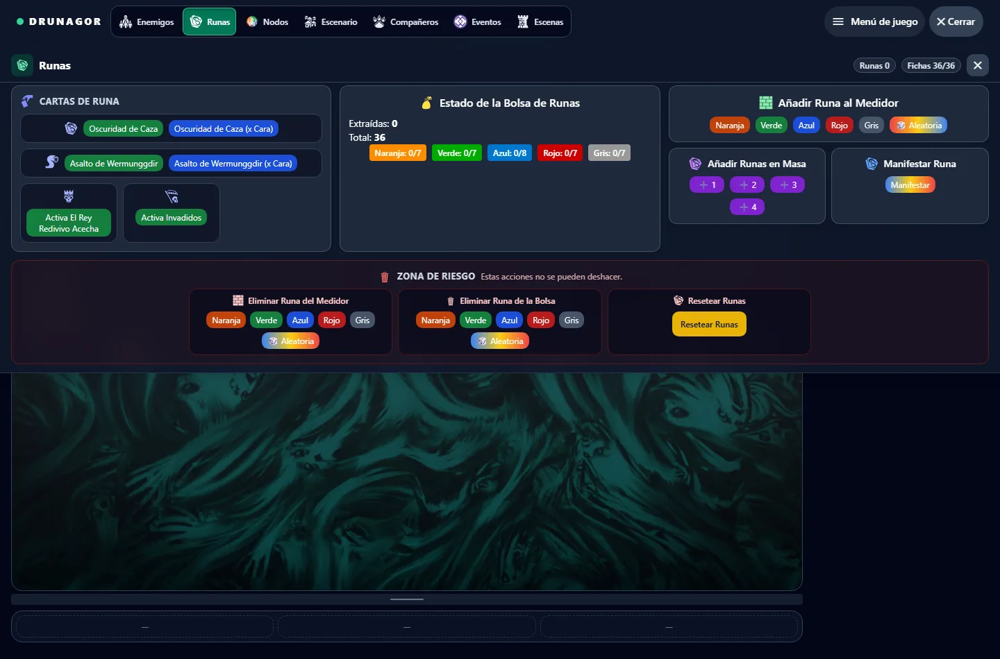

El menú se divide en:

1. **Cartas de runa**.
2. **Estado de la bolsa**.
3. **Añadir al medidor / manifestar / Oscuridad Inquieta**.
4. **Zona de riesgo**.

#### Cartas de runa

Incluye cartas como:

- Oscuridad de Caza.
- Asalto de Wermunggdir.
- Acecho del Rey Redivivo.
- Invadidos.
- Runas de Despertar.

Cada carta puede añadirse por cara A o B si existe. La app evita duplicados incompatibles cuando corresponde.

#### Bolsa y medidor

- **Extraídas**: fichas que ya han salido de la bolsa.
- **Total**: total inicial disponible.
- Cada color muestra sus fichas restantes.

#### Añadir runa al medidor

Puedes añadir una ficha de un color concreto o una ficha aleatoria.

#### Oscuridad Inquieta

Añade X runas de cada color al medidor de una vez. Puedes elegir entre 1 y 6; si un color no tiene suficientes fichas en la bolsa, se añaden las disponibles.

#### Manifestar

Coloca una runa manifestada según el flujo de la app.

#### Mecánicas de runas

- **Acecho**: activa la mecánica del Rey Redivivo.
- **Invadidos**: activa la mecánica de invasión.
- **Monstruo Huésped**: pasiva de robo de runas al derrotar enemigos.

Estas mecánicas muestran un aviso sobre el track y solo aparecen en la campaña a la que pertenecen.

#### Zona de riesgo

- Eliminar runa del medidor.
- Eliminar runa de la bolsa.
- Resetear runas.

Las acciones destructivas piden confirmación.

---

### 9.3 Nodos y áreas

El menú **Nodos** agrupa:

- **Pilas de runas**.
- **Pilas concentradas / niebla**.
- **Nodos de Oscuridad**.
- **Control de áreas**:
  - Barricadas.
  - Puntos de aparición.
  - Llaves rúnicas.
  - Rescate de aldeanos.

Cada panel permite añadir, activar, retirar o resolver. La zona de riesgo final permite resetear las mecánicas del menú.

---

### 9.4 Escenario

El menú **Escenario** contiene:

- **Monstruo de escenario**: elige uno de los disponibles para la campaña.
- **Incursión de Monstruos**: añade la carta y sus efectos.
- **Defensa**: añade la carta de defensa con marcador de tiempo.

La selección del monstruo condiciona algunas cartas de incursión. Si una carta necesita un monstruo y no hay ninguno seleccionado, el botón queda deshabilitado.

Al final hay una **zona de riesgo** para quitar:

- El monstruo de escenario.
- Las cartas de incursión.
- Las cartas de defensa.

> **Captura sugerida:** menú Escenario con un monstruo seleccionado, la carta de incursión habilitada y la zona de riesgo al final.

---

### 9.5 Compañeros

El menú **Compañeros** permite:

- Añadir compañeros.
- Añadir mascotas.
- Añadir seguidores.
- Elegir el héroe activo al que se asocian.
- Abrir su ficha para vida, estados y capacidades.
- Resetear vida y estados.

En el track, el compañero aparece **detrás de su héroe** y participa en el orden de iniciativa. Las mascotas usan el mismo sistema de tarjeta.

---

### 9.6 Eventos y mecánicas especiales

Aquí se activan las mecánicas que no pertenecen a una escena concreta:

- **Sorpresa Enterrada**.
- **Monstruo Huésped**.
- **Ocuridad Eterna**.
- **Mazos especiales** de Despertar:
  - PS del Navío Corrupto.
  - PS del Buque Cisne.
  - Asedio de Limiternia.
  - Sorpresa de Eradren.

Las mecánicas muestran un aviso persistente sobre el track. Algunas solo están disponibles en su campaña; por ejemplo, Ocuridad Eterna pertenece al juego base.

> **Captura sugerida:** menú Eventos con el aviso de Ocuridad Eterna activo y el aviso correspondiente sobre el track.

---

### 9.7 Escenas

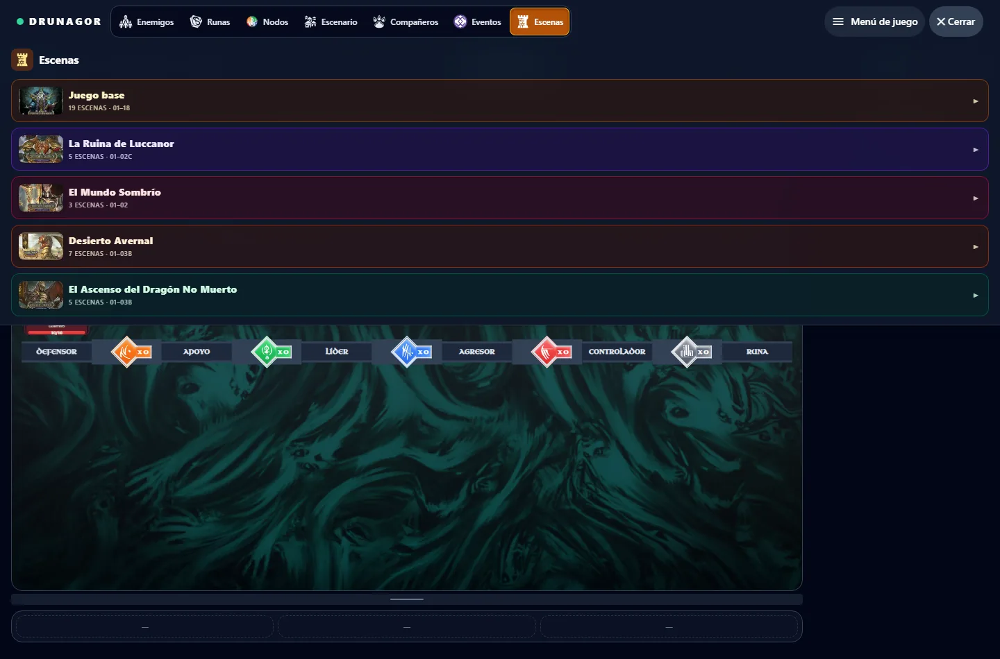

Las escenas están agrupadas por **juego o expansión**:

- Juego base.
- Despertar.
- Luccanor.
- El Mundo Sombrío.
- Desierto Avernal.
- El Ascenso del Dragón No Muerto.
- Futuras expansiones.

Cada grupo:

- Está **plegado por defecto**.
- Muestra imagen, nombre, número de escenas y rango de capítulos.
- Se despliega al pulsar la cabecera.
- Ordena sus escenas por capítulo.

#### Activar una escena

Pulsa una escena para aplicar su preparación. Según la escena, la app puede:

- Reiniciar enemigos, runas y tablero.
- Conservar las runas del track.
- Eliminar compañeros no permitidos.
- Añadir enemigos según el número de héroes.
- Añadir cartas de runa o incursión.
- Activar un Nodo de Niebla.
- Activar un jefe.
- Preguntar por estados, trauma o maldición.

#### Escenas secuenciales

Algunas escenas están pensadas para jugarse seguidas:

- Conservan las runas del track.
- Limpian estados no permitidos.
- Mantienen trauma y maldición.
- Reinician enemigos u otros elementos.

La app muestra un aviso/resumen cuando aplica la escena.

#### Escenas con letra

Las escenas con letra (`01b`, `02b`, `02c`…) suelen ser continuaciones. Su comportamiento puede variar: algunas no reinician el tablero, otras sí. Comprueba siempre el resumen y las confirmaciones.

> **Importante:** activa una escena solo cuando vayas a empezar ese capítulo. La preparación modifica el estado actual.

---

### 9.8 Menú de juego

El botón **Menú de juego** reúne:

| Opción | Uso |
|---|---|
| **Partidas** | Guardar, cargar, exportar e importar |
| **Música** | Control de música, si está disponible |
| **Ver contenido de otras campañas** | Muestra contenido de otra caja sin cambiar la partida |
| **Inicio** | Vuelve a la portada |
| **Volver a configuración** | Cambia idioma, expansiones o reglas |
| **Historia** | Abre el Seguimiento de Historia: objetos compartidos y registro de campaña |
| **Fase de Campamento** | Limpia el track, cura al grupo y guarda |
| **Aventura Secuencial** | Prepara el siguiente capítulo conservando recursos |
| **Reiniciar partida** | Reinicio por grupos |

---

## 10. Héroes, estados y recursos

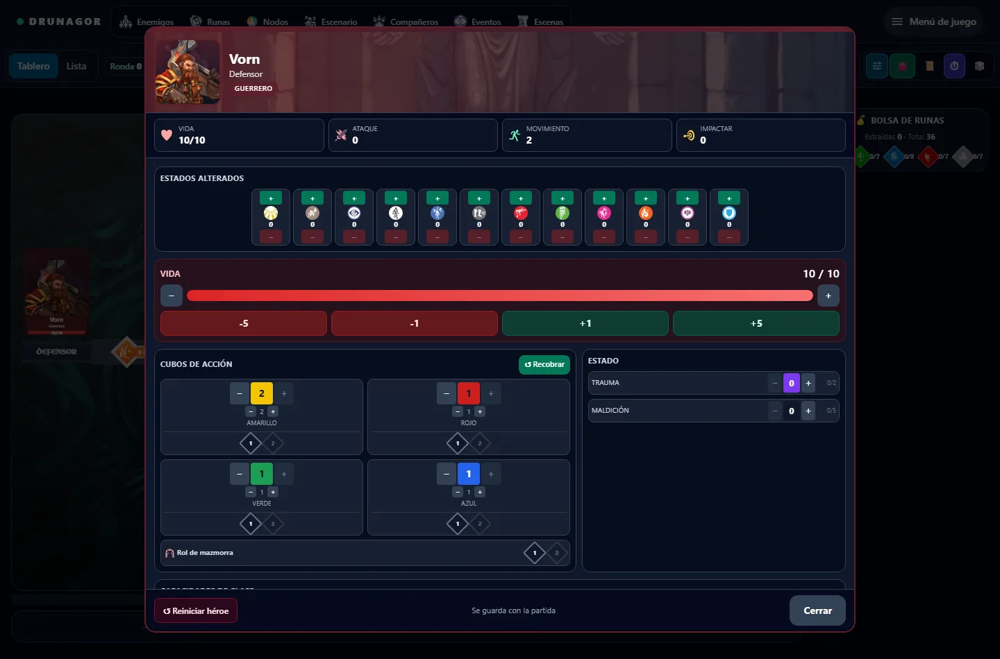

Haz clic en la tarjeta de un héroe para abrir su ficha ampliada. Desde ella puedes consultar y modificar:

- **Vida actual y máxima**.
- **Estados alterados**.
- **Cubos de acción**.
- **Trauma y maldición**.
- **Habilidades y capacidades**.
- **Equipo y objetos**.
- **Recursos de clase**: Concentración, Ki, Furia, Fruto de Vida.

### Estados más habituales

| Estado | Para qué sirve |
|---|---|
| **Escudo** | Protección acumulable |
| **Ki** | Recurso de monje |
| **Concentración** | Recurso general |
| **Fruto de Vida** | Recurso de druida |
| **Furia** | Recurso de bárbaro |
| **Entropía** | Recurso especial |
| **Veneno, Quemadura, Hemorragia** | Condiciones de daño |
| **Derribo, Aturdimiento, Lentitud** | Condiciones de control |
| **Sigilo, Fragilidad, Restricción** | Estados defensivos o limitantes |

Los estados se muestran junto a la vida del héroe y en la ficha ampliada. La ficha se divide en dos zonas: todo lo que hay hasta la gestión de la vida y, debajo, el **Diario de Campaña**, que agrupa cubos, habilidades, compañeros, equipo, almacén, auras, consecuencias, estados y tiempo total con un fondo diferenciado.

Cada héroe puede tener **una sola aura**. Al recibir un cubo de Trauma o al elegir otra, el aura anterior se elimina. El líder puede escoger las 20 auras base; el resto de héroes, solo las individuales. Algunas auras del líder son privadas y otras se muestran a todo el grupo. Durante el turno del héroe, el track muestra un aviso con su nombre, el aura y la capacidad; las auras de grupo aparecen también en los turnos de los demás héroes.

Las **consecuencias (Outcomes)** son compartidas por todo el grupo. Se pueden anotar sin límite, no se repiten y viven en el **Seguimiento de Historia**; el mismo panel aparece en el Diario de Campaña de cada héroe para consultarlas o cambiarlas. El juego base incluye 15, entre ellas *Héroe corrupto*, marcada como especial.

### Cubos de acción

Los cubos se recobran y se gastan durante la partida. La app permite marcarlos y consultarlos. En el campamento o al reiniciar héroes se recuperan al máximo.

### Compañeros y seguidores

- Se añaden desde **Compañeros**.
- Se colocan detrás de su héroe.
- Tienen vida, estados y ficha propia.
- Los seguidores se gestionan con el mismo flujo.
- El menú y las fichas están disponibles en español e inglés: tipos, alias, estados, avisos y botones se traducen.
- El roster se filtra por campaña: el juego base no muestra seguidores; **Despertar** tiene seis y **Apocalipsis** diez (seis seguidores y cuatro **Acompañantes**). La vista previa de otras campañas permite consultar los dieciséis.
- En Apocalipsis, **Robin Rising** permite elegir entre los perfiles **Herido** y **Sano**; el resto tiene un perfil único.
- Los **Acompañantes** funcionan igual que los seguidores en el track y en el turno, pero no se guardan entre aventuras: no se añaden al campamento, no se restauran con la partida y se eliminan al reiniciar.
- Nombres, epítetos, perfiles y capacidades cambian con el idioma de la interfaz.
- Los estados alterados de la ficha se gestionan con iconos, contador y botones ±, igual que en héroes y enemigos.

---

## 11. Enemigos, comandantes y jefes

Haz clic en una carta de enemigo para abrir su ficha. Desde ella puedes:

- Consultar vida, ataque, movimiento e inmunidades.
- Cambiar vida.
- Añadir o quitar estados.
- Voltear cartas de doble cara.
- Eliminar el enemigo del track.

### Diferencia entre categorías

| Categoría | Comportamiento en la app |
|---|---|
| **Bisoño / Soldado / Veterano / Campeón** | Enemigos normales; se apilan en el track |
| **Comandante** | Pregunta PC y coloca cartas de ataque |
| **Señor Supremo** | Usa baraja propia |
| **Jefe** | Banner destacado, preguntas de trauma/maldición y cartas de jefe |
| **Héroe caído** | Carta especial de héroe derrotado |
| **Escenario** | Se coloca desde el menú Escenario o una escena |

### Jefes con preguntas

Al invocar un jefe, la app puede preguntar por cubos retirados:

- **Trauma**: aumenta la vida según el valor del jefe.
- **Maldición**: aumenta la vida según el valor del jefe.

Ejemplos implementados:

- **Wermunggdir**: +10 por trauma, +2 por maldición.
- **Aral’hezec**: +5 por trauma, +1 por maldición.

### Banner del jefe

Si hay un jefe activo, aparece una ficha grande sobre el track con:

- Retrato ajustado al marco.
- Nombre.
- Vida y barra.
- Inmunidades.
- Acceso a su ficha.
- Botón para compactar/expandir.

### Ataques encadenados

Algunas cartas de jefe incluyen “ejecuta todos los ataques”. La app muestra debajo los ataques calculados según la runa de la carta, por ejemplo:

- Aliento de Dragón.
- Golpe de Alas.
- Golpe de Cola.

El valor de X se calcula automáticamente.

> **Captura sugerida:** ficha de un jefe con el retrato, la barra de vida, las inmunidades y el desplegable de ataques.

---

## 12. Runas, oscuridad y economía de fichas

La app distingue tres zonas:

1. **Bolsa**: fichas disponibles.
2. **Track/medidor**: fichas extraídas o colocadas.
3. **Pilas, nodos y áreas**: fichas agrupadas para mecánicas concretas.

### Reglas de uso

- Añadir una runa al medidor descuenta una ficha de la bolsa.
- Algunas acciones devuelven fichas, otras las descartan.
- Las runas del track pueden conservarse entre capítulos secuenciales.
- Las cartas de runa no siempre vuelven a la bolsa al retirarse.
- La bolsa muestra el total por color para detectar desajustes.

### Pilas y nodos

- **Pila de runas**: agrupación de runas que se puede activar, devolver o usar en combate estrecho.
- **Pila concentrada / niebla**: nodo con runas y efectos de área.
- **Nodo de Oscuridad**: mecánica de campaña posterior.

### Ocuridad Eterna

Cuando está activa:

- Todas las casillas están bajo Oscuridad.
- Los enemigos invocados ganan **+2 al ataque**.
- El ataque se muestra como valor original/modificado, por ejemplo `5/7`.

Solo aparece en el juego base.

---

## 13. Guardados, exportación e importación

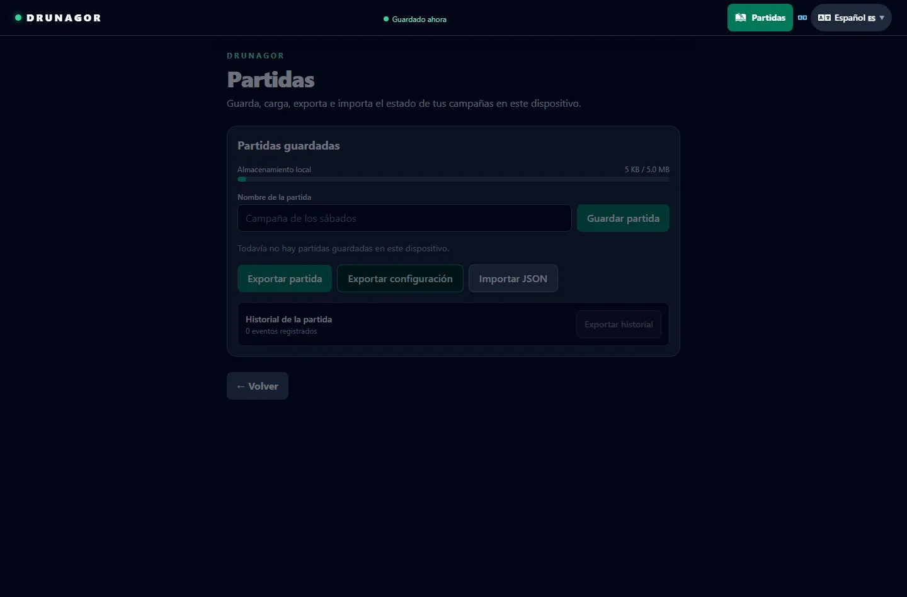

### Autoguardado

La app guarda automáticamente el estado en `localStorage`:

- Track.
- Turno y ronda.
- Enemigos.
- Runas y fichas.
- Héroes y estados.
- Campamento: objetos, nombre del grupo, registro de historia y consecuencias compartidas.
- Seguidores reclutados en el campamento. Los **Acompañantes** quedan fuera a propósito: no se guardan ni se restauran.

### Partidas manuales

- Puedes guardar hasta **10 partidas** con nombre.
- Cada guardado completo incluye la configuración, el estado del track, el registro de historia y los seguidores reclutados.
- El alcance **solo configuración** conserva el nombre del grupo y el registro de historia (viven dentro de la configuración), pero no el roster de seguidores.
- El indicador superior muestra el espacio usado.

### Exportar

Tres alcances:

| Exportación | Contenido |
|---|---|
| **Partida completa** | Configuración + track + estado + seguidores reclutados |
| **Solo configuración** | Campaña, expansiones, héroes, roles, enemigos, nombre del grupo y registro de historia |
| **Solo track** | Estado actual de la partida, incluidos los seguidores reclutados |

### Importar

1. Pulsa **Importar JSON**.
2. Selecciona el archivo.
3. La app valida y sanea los datos contra los catálogos actuales.
4. Las entradas desconocidas se descartan.
5. Los guardados de versiones 1–3 siguen siendo compatibles; si son antiguos y no traen seguidores, se cargan sin ellos.
6. Se aplica el guardado. Una partida completa restaura también el campamento de seguidores.

### Limitaciones

- No hay sincronización entre dispositivos.
- Limpiar los datos del navegador borra las partidas no exportadas.
- El espacio es limitado; la app avisa al acercarse al límite.
- El alcance **solo configuración** no incluye los seguidores reclutados: usa **partida completa** si quieres viajar con todo.

> **Consejo:** exporta una copia antes de un jefe, un cambio de campaña o una actualización importante.

---

## 14. Reiniciar partida

El reinicio está agrupado para evitar opciones excesivas:

| Opción | Qué reinicia |
|---|---|
| **Runas** | Runas, fichas, pilas, nodos y mecánicas activas |
| **Héroes, compañeros, mascotas y seguidores** | Vida, estados, recursos y cubos |
| **Enemigos** | Enemigos, cartas de ataque y monstruo de escenario. Activado por defecto |
| **Eventos, mazos especiales y aldeanos** | Sorpresas, mazos, cañones, Visión Clara y aldeanos |

Siempre se reinician:

- Turno.
- Historial.
- Sesión de turno.
- Puntos de generación.
- Cañones mágicos.
- Asedio y Jabalí Parpadeante.

---

## 15. Historia y aventura secuencial

### Seguimiento de Historia

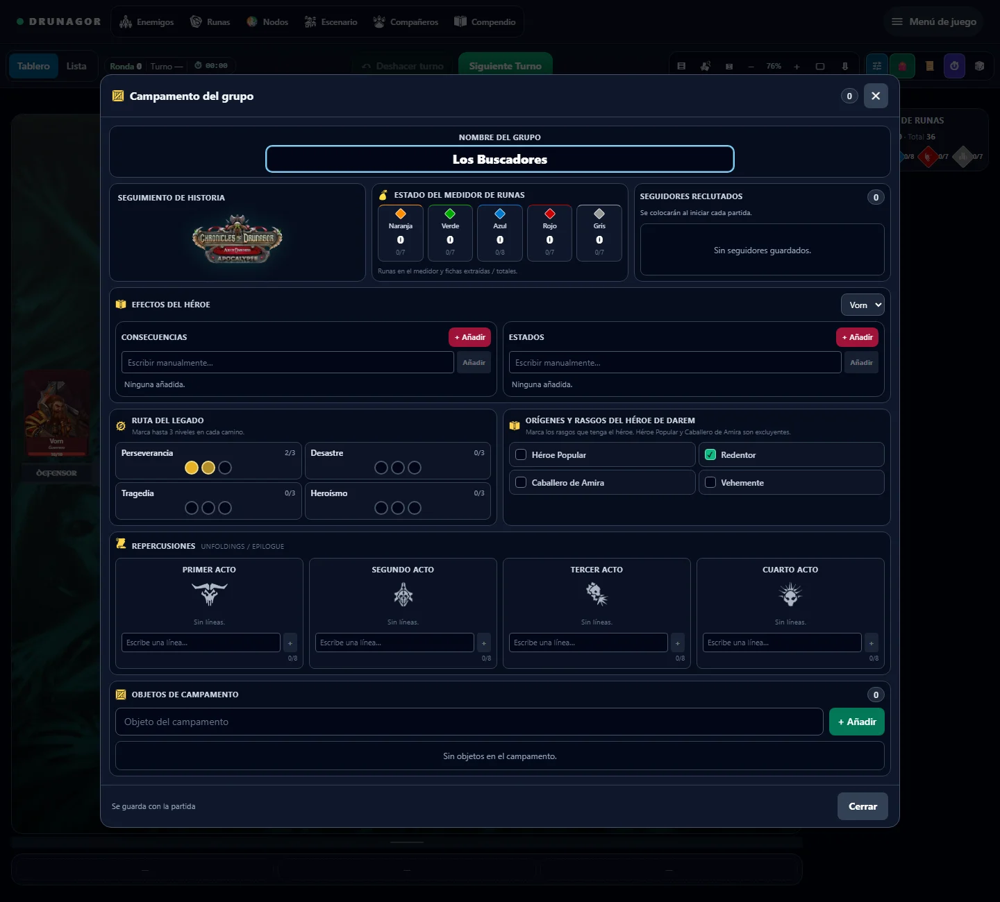

El **Seguimiento de Historia** guarda objetos compartidos del grupo y el registro de la campaña. Es un almacén común, no una tienda.

El diálogo se organiza de arriba abajo: nombre del grupo centrado; seguimiento de historia de la campaña, medidor de runas y seguidores reclutados; panel compartido de consecuencias junto a los estados del héroe; y, al final, los objetos. En **Apocalipsis** aparecen además la **Ruta del Legado** (cuatro caminos en 2 columnas × 2 filas, con tres niveles cada uno), los rasgos del **Héroe de Darem** (Héroe Popular y Caballero de Amira son excluyentes) y las **Repercusiones**, con una columna por acto para escribir líneas propias.

La fila superior se adapta a la campaña: **Despertar** y **Apocalipsis** muestran **Seguidores Reclutados**; Apocalipsis lo hace siempre, aunque todavía esté vacío, porque los seguidores se introducirán más adelante. El juego base oculta ese bloque.

### Fase de Campamento

La fase de campamento:

- Limpia el track.
- Cura al grupo.
- Guarda la partida.
- Deja la configuración de héroes y roles disponible.

### Aventura Secuencial

La aventura secuencial:

- Conserva recursos.
- Recoloca runas.
- Guarda el estado.
- Permite continuar con el siguiente capítulo.

Usa esta opción entre capítulos cuando quieras mantener la progresión sin empezar de cero.

---

## 16. Visualización, accesibilidad y rendimiento

### Vistas

- **Tablero**: cartas apiladas alrededor de la barra.
- **Lista**: filas compactas con desplegables.
- **Vista simplificada**: enemigos como fichas pequeñas.
- **Modo presentación**: oculta controles secundarios.

### Ajustes visuales

- **Zoom**: cambia el tamaño del tablero.
- **Densidad**: reduce cartas y separaciones.
- **Solape**: acerca las cartas de una pila.
- **Paneles debajo**: reorganiza la pantalla en pantallas estrechas.
- **Controles del track**: oculta la barra de herramientas.

### Accesibilidad

- La app usa texto además de color.
- Los menús tienen etiquetas ARIA.
- Los botones tienen estados `aria-pressed` o `aria-expanded`.
- El foco se mantiene visible.
- El idioma se puede cambiar en caliente.

> **Captura sugerida:** comparativa lado a lado de vista normal, compacta y simplificada.

---

## 17. Estrategias de uso recomendadas

Estas son estrategias para sacar partido a la app, no tácticas del juego:

1. **Configura una vez** las expansiones y la versión de reglas.
2. **Exporta** antes de un jefe o de un cambio de capítulo.
3. **Usa guardados con nombre** para “antes del boss”, “campamento” y “final de sesión”.
4. **Activa la escena** solo al empezar el capítulo.
5. **Añade el jefe al final** de la preparación de la escena.
6. **Usa enemigos manuales** para criaturas concretas que no quieras sortear.
7. **Revisa la bolsa** después de cada escena secuencial.
8. **Usa la vista simplificada** cuando haya muchos enemigos.
9. **Usa modo presentación** si juegas con una pantalla compartida.
10. **Exporta el historial** si quieres conservar la crónica de la sesión.

---

## 18. Problemas frecuentes

### “No me deja entrar al tablero”

La ruta `/init` exige al menos un héroe. Si no hay héroes, la app redirige a la configuración.

### “He perdido la partida”

Comprueba:

1. Que estás en el mismo navegador y dispositivo.
2. Que no has limpiado los datos del sitio.
3. Si tienes un JSON exportado, impórtalo.

### “No veo una carta o un enemigo”

- Revisa las expansiones activas.
- Revisa la campaña seleccionada.
- Comprueba los filtros del selector manual.
- En escenas, despliega el grupo de la expansión correcta.

### “Un aviso no se ve”

Los avisos persistentes se apilan encima del track. Si hay varios, se muestran en vertical. Desplázate al inicio del track si hay mucho contenido.

### “La bolsa no cuadra”

- Revisa las fichas extraídas.
- Comprueba si una escena consumió runas para pilas o puntos de aparición.
- Usa la zona de riesgo de Runas solo si quieres reiniciar la economía.

### “El guardado importado no carga”

La app valida los datos. Un archivo de otra versión puede tener entradas desconocidas; se descartan. Exporta de nuevo desde la versión actual.

### “La app va lenta con muchas cartas”

- Activa la vista simplificada.
- Reduce la densidad.
- Baja el zoom.
- Cierra menús abiertos.
- En móvil, usa la vista Lista.

---

## 19. Lista de comprobación rápida

### Antes de la sesión

- [ ] Expansiones correctas.
- [ ] Versión de reglas correcta.
- [ ] Héroes y roles asignados.
- [ ] Enemigos y comportamientos configurados.
- [ ] Guardado/exportación reciente.

### Al empezar un capítulo

- [ ] Escena correcta.
- [ ] Confirmar el resumen de preparación.
- [ ] Revisar runas del track.
- [ ] Revisar enemigos y jefe.
- [ ] Revisar avisos activos.

### Durante el turno

- [ ] Turno actual identificado.
- [ ] Vida y estados actualizados.
- [ ] Cubos y recursos actualizados.
- [ ] Cronómetro visible.
- [ ] Siguiente turno solo cuando la mesa haya terminado.

### Al terminar

- [ ] Guardar con nombre.
- [ ] Exportar copia.
- [ ] Anotar incidencias en el historial.
- [ ] Cerrar sesión o dejar el estado preparado para continuar.

---

## 20. Guía de figuras y capturas para la ayuda

| Figura | Archivo | Qué debe mostrar | Anotaciones recomendadas |
|---|---|---|---|
| 1 | `tutorial/assets/01-inicio.webp` | Portada | Continuar, Configurar, Partidas, Tutorial, idioma |
| 2 | `tutorial/assets/02-configuracion.webp` | Expansiones | Activa/inactiva, versión de reglas, guardado |
| 3 | `tutorial/assets/03-seleccion.webp` | Asistente | Pasos, campaña, héroes, roles, enemigos |
| 4 | `tutorial/assets/04-tablero.webp` | Tablero | Menús, barra, pilas, bolsa, carrusel |
| 5 | `tutorial/assets/05-escenas.webp` | Escenas | Grupos plegados, imagen, rango de capítulos |
| 6 | `tutorial/assets/06-runas.webp` | Runas | Cartas, bolsa, medidor, masa, zona de riesgo |
| 7 | `tutorial/assets/07-guardados.webp` | Partidas | Guardar, exportar, importar, historial |
| 8 | `tutorial/assets/08-enemigos.webp` | Enemigos | Aleatorios, manuales, filtros, zona de riesgo |
| 9 | `tutorial/assets/09-ficha-heroe.webp` | Ficha de héroe | Vida, estados, cubos, trauma, maldición |
| 10 | `tutorial/assets/10-campamento.webp` | Campamento | Nombre, historia, runas, seguidores, Ruta, Daren, Repercusiones |

### Capturas adicionales recomendadas

- Ficha de enemigo con inmunidades y botón de volteo.
- Banner de jefe con retrato e inmunidades.
- Menú de Escenario con monstruo, incursión y defensa.
- Diálogo de reinicio de partida con sus cuatro grupos.
- Fase de Campamento.

### Diagramas recomendados

- Flujo de inicio y configuración.
- Bucle de turno.
- Árbol de decisión de escenas (normal, secuencial, evento con letra).
- Mapa de menús del track.
- Leyenda de colores e iconos.

---

## 21. Glosario

| Término | Definición |
|---|---|
| **Track** | Tablero de iniciativa con 11 posiciones |
| **Slot** | Posición del track |
| **Ronda** | Una vuelta completa al orden de iniciativa |
| **Turno** | Activación de una entidad |
| **Iniciativa** | Orden en el que actúan héroes, enemigos y runas |
| **Runa** | Ficha de color que se extrae de la bolsa |
| **Bolsa** | Fichas disponibles |
| **Medidor** | Runas colocadas en el track |
| **Pila** | Conjunto de runas agrupadas |
| **Nodo** | Agrupación de oscuridad/niebla con efecto de área |
| **Compañero** | Criatura asociada a un héroe |
| **Mascota** | Compañero de tipo mascota |
| **Seguidor** | Aliado que sigue a un héroe |
| **PC** | Valor de poder de un comandante |
| **Escena** | Preparación automática de un capítulo |
| **Campaña** | Caja principal: base, Despertar o Apocalipsis |
| **Expansión** | Contenido adicional de una campaña |

---

## 22. Cierre

Ya conoces el flujo completo:

1. Configurar.
2. Crear la partida.
3. Preparar la mesa.
4. Jugar los turnos.
5. Gestionar runas, enemigos, héroes y escenario.
6. Guardar y exportar.

La mejor forma de aprender es hacer una partida de prueba con un héroe, un enemigo y una runa. Cuando domines ese ciclo, añade compañeros, jefes y escenas.

> **Regla de oro:** si algo no cuadra, revisa el estado antes de reiniciar. La app conserva mucho contexto y casi siempre es más rápido corregir que empezar de cero.
